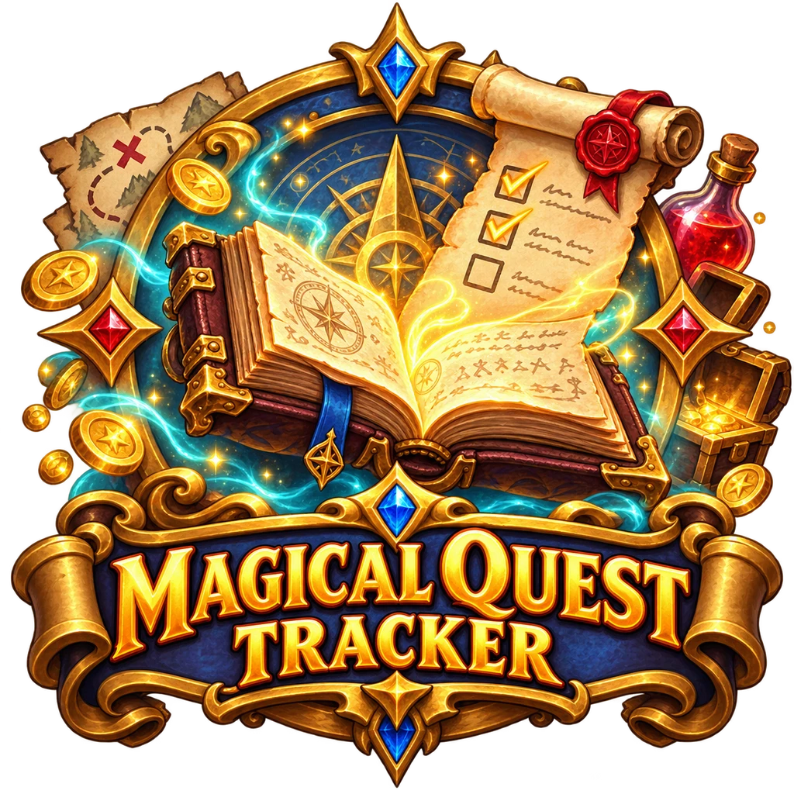

<p align="center"></p>

<h3 align="center">Il diario delle missioni in mano al master, per Foundry VTT 13 e 14</h3>

<p align="center">Missioni, obiettivi e premi · divisione automatica del bottino · visibile ai giocatori solo quando lo permetti · missioni già pronte nelle avventure</p>

<p align="center">
  <a href="https://github.com/morningstar3010/magical-quest-tracker/releases"></a>
  
  <a href="https://github.com/morningstar3010/magical-quest-tracker/releases"></a>
</p>

<p align="center">
  <a href="README.md" title="English"></a>
  <a href="README.it.md" title="Italiano"></a>
</p>

<p align="center">
  🌐 <a href="README.md">English</a> · <b>Italiano</b>
</p>

---

**Magical Quest Tracker** tiene tutte le missioni della campagna in un pannello privato. Decidi tu quali missioni esistono, quali sono attive e quali possono vedere i giocatori. Quando una missione è completata scegli chi riceve ogni premio: oggetti, valuta ed esperienza finiscono da soli nelle schede dei personaggi.

## Indice

1. [Installazione](#install)
2. [La prima missione in un minuto](#quick-start)
3. [Il pannello del master](#panel)
4. [Che cosa vedono i giocatori](#players)
5. [Completare una missione e dividere i premi](#rewards)
6. [Le missioni delle avventure](#adventures)
7. [Impostazioni e lingua](#settings)
8. [Per chi scrive avventure](#authors)
9. [Macro](#macros)

<a name="install"></a>
## 1. Installazione

1. In Foundry apri **Moduli aggiuntivi** e premi **Installa modulo**.
2. Nel campo **URL del manifest** incolla questo indirizzo e premi **Installa**:

```
https://github.com/morningstar3010/magical-quest-tracker/releases/latest/download/module.json
```

3. Apri il tuo mondo, vai in **Gestisci moduli**, spunta **Magical Quest Tracker** e salva.

<a name="quick-start"></a>
## 2. La prima missione in un minuto

- [ ] Clicca il pulsante **Magical Quest Tracker** (la pergamena) nella barra a sinistra, oppure l'icona dell'elenco nel riquadro **Missioni** in cima alla scheda dei Diari.
- [ ] Premi **Nuova missione** e scrivi un titolo.
- [ ] Trascina una pozione da un compendio qualsiasi dentro **Premi** e scrivi 100 in **mo**.
- [ ] Premi **Attiva**, poi **Mostra nei diari dei giocatori**.
- [ ] Fatto! I giocatori vedono la missione in cima alla loro scheda dei Diari.

<a name="panel"></a>
## 3. Il pannello del master

A **sinistra** c'è l'elenco delle missioni: ricerca per nome, zona, descrizione o PNG, filtro per zona e per PNG, e le schede **Tutte**, **Disponibile**, **Attiva**, **Completata** e **Fallita**. In fondo, **Missioni delle avventure** elenca le missioni scritte nelle avventure importate e non ancora aggiunte: **Aggiungi al tracker** oppure **Attiva subito**.

A **destra** c'è la missione scelta. Ogni campo si salva da solo:

| Campo | Che cos'è |
|---|---|
| Immagine, Titolo, Stato, Zona | i dati principali; la zona serve anche da filtro |
| Visibile ai giocatori | ai giocatori compaiono solo le missioni visibili |
| Personaggi non giocanti | scrivi un nome e premi Invio, oppure trascina un attore |
| Riassunto, Descrizione | una riga breve e il testo completo (con collegamenti, tiri e immagini) |
| Obiettivi | facoltativi; spuntali man mano che il gruppo va avanti; quelli **segreti** li vede solo il master |
| Premi | trascina oggetti da qualsiasi compendio o dalla barra degli oggetti e scegli la quantità; valuta, PE e altri premi; **Premi visibili ai giocatori** |
| Scadenza | facoltativa, testo libero |
| La seguono | i personaggi che hanno preso la missione |

Pulsanti: **Attiva**, **Completata…** (apre la divisione dei premi), **Fallita**, **Riapri**, **Mostra nei diari dei giocatori** / **Nascondi ai giocatori**, **Apri ai giocatori** (apre la scheda della missione sullo schermo di ogni giocatore), **Scheda**, **Duplica**, **Elimina**.

<a name="players"></a>
## 4. Che cosa vedono i giocatori

- In cima alla scheda dei **Diari**, il riquadro **Missioni** con le missioni visibili divise in *In corso*, *Disponibili*, *Completate* e *Fallite*, con gli obiettivi raggiunti.
- Cliccando una missione si apre la sua **scheda**: immagine, zona, PNG, descrizione, obiettivi (non quelli segreti), premi (se li mostri), scadenza, chi la segue e **Le mie note**, appunti personali che vede solo quel giocatore.

<a name="rewards"></a>
## 5. Completare una missione e dividere i premi

Premi **Completata…**:

1. spunta i personaggi che ricevono i premi (quelli che seguono la missione sono già spuntati);
2. per ogni **oggetto** scegli quanti ne riceve ciascuno (il totale diventa verde quando torna);
3. **valuta** e **PE**: *in parti uguali* (il resto va ai primi) oppure *decido io*;
4. premi **Consegna i premi e completa**.

Con D&D 5e gli oggetti vanno negli inventari (la quantità si somma se il personaggio ha già lo stesso oggetto), valuta e PE si sommano nelle schede. Con altri sistemi di gioco gli oggetti si consegnano lo stesso, mentre valuta e PE vengono scritti nel resoconto in chat. **Completa senza premi** chiude la missione e basta.

<a name="adventures"></a>
## 6. Le missioni delle avventure

Alcune avventure contengono già le loro missioni. Sono scritte nei diari dell'avventura, non in questo modulo: dopo l'importazione compaiono in **Missioni delle avventure** nel pannello. Nella pagina del diario la missione è un collegamento: il master lo clicca, legge l'anteprima e sceglie **Attiva**, **Attiva e mostra ai giocatori** oppure **Aggiungi senza attivare**.

<a name="settings"></a>
## 7. Impostazioni e lingua

- **Lingua di Magical Quest Tracker**: «Automatica» segue Foundry; altrimenti English, Italiano, Deutsch o Español (cambiano solo i testi di questo modulo).
- **Missioni in cima ai Diari**: mostra o nasconde il riquadro.
- In **Configura comandi**: un tasto per aprire il pannello.

<a name="authors"></a>
## 8. Per chi scrive avventure

Metti le missioni nei flag di una pagina di diario della tua avventura e un richiamo nel suo testo:

```json
"flags": { "magical-quest-tracker": { "missioni": [ {
  "id": "taglia-gargoyle-verde",
  "titolo": "Il corno del gargoyle verde",
  "zona": "Palude del Drago",
  "png": ["Zhanna"],
  "riassunto": "Zhanna paga 250 mo per il corno.",
  "descrizione": "<p>Portare a Zhanna il corno di un gargoyle guardiano verde.</p>",
  "obiettivi": [ { "testo": "Trovare un gargoyle guardiano verde" }, { "testo": "Portare il corno a Zhanna" } ],
  "ricompense": { "valuta": { "gp": 250 }, "pe": 0, "oggetti": [ { "uuid": "Compendium.mio-modulo.oggetti.Item.xxxxxxxxxxxxxxxx", "nome": "Pozione", "quantita": 1 } ] }
} ] } }
```

```
@Missione[taglia-gargoyle-verde]{Il corno del gargoyle verde}
```

Funziona anche `@Quest[…]`. Senza il tracker installato il testo resta com'è scritto.

<a name="macros"></a>
## 9. Macro

```js
const q = game.modules.get("magical-quest-tracker").api;
q.pannello();                       // apre il pannello del master
q.crea({ titolo: "Salvare il mercante", zona: "Zelkor" });
q.missioni();                       // tutte le missioni
q.attiva(id); q.fallita(id);        // cambia stato
q.completa(id);                     // apre la divisione dei premi
q.mostra(id);                       // apre la scheda della missione a tutti i giocatori
q.definizioni();                    // missioni scritte nelle avventure importate
q.daAvventura("taglia-gargoyle-verde", { stato: "attiva", visibile: true });
```

---

<p align="center">Realizzato da <b>MorningStar</b></p>
